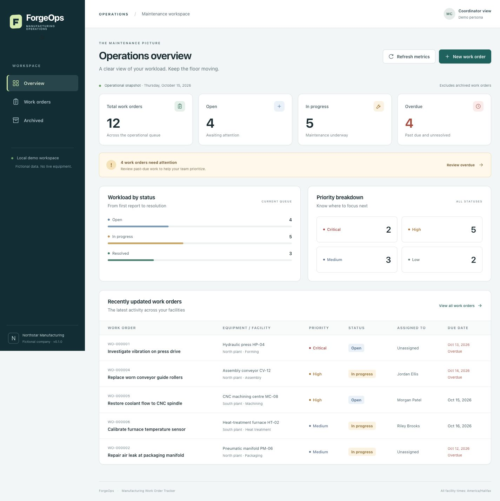

# ForgeOps — Manufacturing Work Order Tracker

**C# · ASP.NET Core MVC · EF Core · SQLite · REST API · xUnit**

[Live demo](https://forgeops-mbelsabah.onrender.com) · [Build & test workflow](https://github.com/MBELSABAH/ForgeOps/actions/workflows/ci.yml)

ForgeOps is an independent, full-stack application for tracking manufacturing maintenance work orders. It demonstrates business rules, relational data, service-oriented application design, API integration, and automated verification using fictional facilities, technicians, and work orders.

## Features

- **Operations dashboard:** database-derived status, priority, overdue, and recent-activity metrics.
- **Work orders:** create, edit, assign to a technician, search, filter, and inspect full details.
- **Workflow controls:** move orders between Open, In Progress, and Resolved; require resolution notes and allow reopening.
- **Audit history:** preserve meaningful changes and prior resolution notes.
- **Reversible archiving:** remove orders from active queues without losing their records.
- **Responsive interface:** Razor views, Bootstrap, and Fetch-based interactions with server-side validation.

The public demo is unauthenticated and uses **fictional data only**. Please do not enter personal, confidential, or production information.

## Technology and architecture

| Layer | Technology |
|---|---|
| Backend | C#, .NET 10, ASP.NET Core MVC and Web API |
| Persistence | Entity Framework Core, SQLite |
| Frontend | Razor, Bootstrap, HTML/CSS, JavaScript Fetch |
| Testing | xUnit, ASP.NET Core WebApplicationFactory, isolated SQLite integration databases |
| Delivery | Git, GitHub Actions, Docker/Render for the public demo |

Both MVC and API controllers share an injected work-order service. Business validation is centralized, reads use asynchronous EF Core queries, and order changes are saved together with their audit entries. An injectable clock handles date-only deadlines in the America/Halifax time zone.

See [architecture and database design](docs/DESIGN.md).

## Run locally

Requires the **.NET 10 SDK** (tested on macOS Apple Silicon). From the repository root:

~~~sh
./scripts/run.sh
~~~

Open **http://127.0.0.1:5080**. The application applies its SQLite migration and initializes fictional demo data on first launch. Changes made locally persist across application restarts.

To run the test suite and Release verification:

~~~sh
./scripts/test.sh
./scripts/check.sh
~~~

The published v0.1.0 verification recorded **45 passing tests** (27 unit and 18 integration cases) and a Release build without warnings or errors. The [GitHub Actions run](https://github.com/MBELSABAH/ForgeOps/actions/runs/38944079344) also completed successfully.

## REST API

The app exposes five API endpoints:

| Method | Endpoint | Purpose |
|---|---|---|
| GET | /api/workorders | List and filter orders |
| GET | /api/workorders/{id} | Retrieve order details and history |
| POST | /api/workorders | Create an order |
| PATCH | /api/workorders/{id}/status | Change an order's status |
| GET | /api/dashboard/summary | Retrieve dashboard metrics |

Example calls on a local instance:

~~~sh
curl 'http://127.0.0.1:5080/api/workorders?status=Open'
curl 'http://127.0.0.1:5080/api/dashboard/summary'
~~~

The application uses typed request/response DTOs, field-specific validation errors, and appropriate HTTP status codes. The OpenAPI specification is available at **/openapi/v1.json** in Development mode.

## Development and verification

- [Product requirements](docs/REQUIREMENTS.md) and [architecture](docs/DESIGN.md)
- [Development iterations](docs/SPRINT_LOG.md) and [test-driven rule development](docs/TDD_WALKTHROUGH.md)
- [Code review and fixes](docs/CODE_REVIEW.md) and [verification evidence](docs/VERIFICATION.md)
- [User guide](docs/USER_GUIDE.md), [troubleshooting](docs/TROUBLESHOOTING.md), and [release notes](docs/RELEASE_NOTES.md)

## Hosting and limitations

The [live demo](https://forgeops-mbelsabah.onrender.com) runs on Render's free service. Cold starts can be slow, and its ephemeral SQLite database may reset on restart or redeployment. Local SQLite persistence is independent of the hosted demo.

This is a **portfolio prototype**, not a production maintenance platform. It has no user authentication or role-based authorization, uses fictional data, and does not implement concurrent-edit protection. A SQL Server EF Core provider path and offline schema generation are available, but SQL Server runtime operations have **not** been tested. No independent end-user acceptance signoff is claimed.

## License / usage

Source is provided as a portfolio reference. No separate open-source license is declared.
